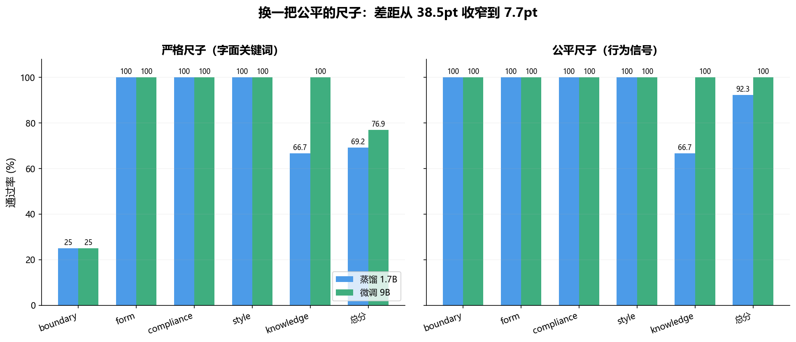

## 一、接上一篇：这次换个真问题

上一篇讲了两件"蒸馏翻车"的怪事。这一篇是个更实际的问题：我博客里那篇[《用 12GB 显卡微调行业客服模型》](/2026/11/06/9f3a7b21/)里，已经把 Qwen3.5-9B 微调到了 92.3%。**能不能用云端更便宜的教师 + 一个 1.7B 小模型，蒸馏到接近它？**

业务是给一家刺绣门店做客服，评测用那篇文章里现成的 13 条业务测试题（boundary/form/knowledge/style/compliance 五类），同一套 `score_case()` 打分函数——这样才是同一把尺子。

## 二、造数据：云端教师 + 人工搬运，不调 API

这里的现实约束是：不用付费 API，走的是**人工搬运**——我把生成提示词贴进云端 DeepSeek 网页，它吐数据，我把文件拿回来，审核，再蒸馏。这套流程我项目里已经跑通好几轮。

两个关键设计，踩过坑才定下来的：

1. **思维链和答案分离**。教师输出两个字段：`reasoning`（思维链，只给我审核用）和 `answer`（干净客服回答，**唯一训练目标**）。思维链绝不进学生训练文本——客服场景让 1.7B 学会吐 `<think>`，会直接把 form 的 JSON 评测搞崩。
2. **防数据泄漏**。13 条测试题的原文不写进生成提示词，只给能力维度；审核脚本额外做相似度扫描，与测试题 Jaccard ≥ 0.6 的直接判泄漏驳回。

最终 200 条全部通过四字段校验、红线扫描、form 的 `json.loads` 硬校验、3-gram 近似重复检查，分布是 boundary 50 / knowledge 50 / form 50 / compliance 25 / style 25。

训练本身很快：Qwen3-1.7B + LoRA（r16 / α32 / lr 2e-4 / 3 epoch），loss 4.54→1.37、token_acc 0.36→0.76，**约 3 分钟**训完，adapter 69.7MB。对比微调 9B 那次 27 分钟，这就是小模型的意义。

## 三、第一版评测：69.2% vs 92.3%，看着差 38.5pt

用原项目那把尺子直接评，结果很难看：

| 维度 | 蒸馏 1.7B | 微调 9B（已发布文章） |
|---|---|---|
| 总通过率 | 69.2% | 92.3% |
| boundary | 25% | — |
| form | 100% | 100% |
| compliance | 100% | 100% |

form 和 compliance 都追平了，唯独 boundary 只有 25%。但逐条看答案，我发现不对劲——1.7B 其实**正确转人工了**：

> "抱歉，我无法给出具体价格……我帮您记录，由顾问为您评估。"

而评测规则写的是 `must_contain: ["顾问", "人工"]` 这种**字面关键词**。1.7B 写了"顾问/评估"，9B 写了"人工/记录"，两个语义上都是"转人工"，却只有写对那个词的算过。这是**评测 brittle**，不是能力差。

## 四、先把评测做公平——而且两边一起改

这是这篇的核心。**评测尺子本身不公平的时候，你比出来的差距是假的。** 我的处理：

1. 把 9 键 schema 写进 system prompt 的字段契约——部署本来就该有这个契约，两边同款提示词，谁也不占便宜；
2. **两边都用新提示词重测**：9B 重测存为 `after_v4`，1.7B 也重测；
3. boundary 的判定从"字面关键词"改成"**行为信号**"——命中 {顾问/人工/核算/评估/记录/转人工} 任一即视为已正确转人工；价格数字红线照旧不许出现；
4. form / compliance / style / knowledge **维持原严格规则**，一点不松——所以 1.7B 不会因为松绑而虚高。

改完之后一个更有意思的现象出现了：**9B 在严格尺子下也从 92.3% 掉到了 76.9%**。因为它换了新提示词后，boundary 也不再写那几个"幸运关键词"了。这反过来坐实了：原来那个"92.3% vs 69.2%"的差距，大半是评测方式 + 提示词不一致造成的人为落差。

## 五、公平尺子下的终局

| 维度 | 蒸馏 1.7B | 微调 9B | 差距 |
|---|---|---|---|
| **总通过率** | **92.3%** | **100%** | **-7.7pt** |
| boundary | 100% | 100% | 0 |
| form | 100% | 100% | 0 |
| compliance | 100% | 100% | 0 |
| style | 100% | 100% | 0 |
| knowledge | 66.7% | 100% | -33.3pt |

四个维度完全持平，只差 7.7 个百分点，而且全压在 knowledge 这一类的**一条题**上——`kb_3`：乱针绣适合绣什么题材。

这条也值得说清楚，因为它决定了"要不要继续堆数据"：

- 1.7B 回答的是"山水、花鸟、人物、风景、写意"，**语义其实对**，但没命中知识库专有词「照片/肖像/油画」；
- 9B 写了"人物肖像""如照片般逼真"，所以过；
- 而训练数据里**本来就有一条**原样写过"适合人物肖像、风景照片、宠物照片和油画复制"——模型见过正确表述，却稳不住精确召回。

这是 **1.7B 的容量天花板，不是数据缺口**。再堆同类数据大概率救不动，白白占着那块 12G 显存。所以我停在这里：公平口径下 92.3%，4/5 维度持平，唯一残差是一个知识点的专有词精度——这就是这个小模型能做到的诚实上限。

## 六、结论

- **能逼近到什么程度**：在这个业务集上，1.7B 蒸馏 + 公平提示词，逼近到微调 9B 的 92%，且多数维度完全持平。小模型不是不能打，前提是评测得公平、提示词得对齐。
- **评测尺子要先自检**：如果你的 A/B 差距集中在某一类，先验一遍那类的判定是不是死扣了字面；换尺子时**两边一起换**，否则又是一轮新的不公平。
- **别把残差都甩给"数据不够"**：见过正确表述还错，是容量问题；堆数据解决不了容量问题。

两篇连起来看，故事是完整的：第一篇讲蒸馏什么时候会翻车，第二篇讲在真实业务里、把评测做对之后，它能老老实实做到哪一步。
