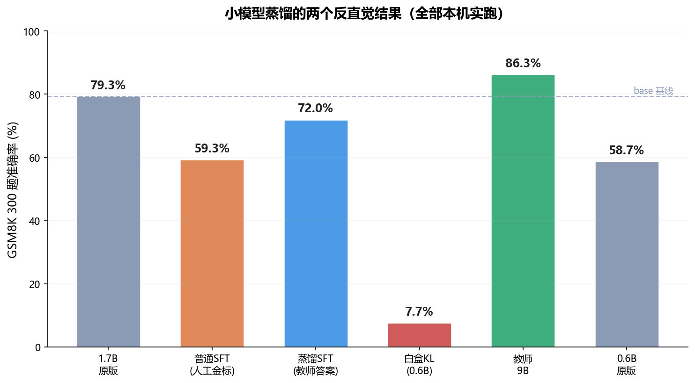

## 一、为什么要做这次"失败实验"

在 12GB 显存的笔记本上，我一直有个朴素的念头：既然大模型那么贵，能不能用**教师模型出题、小模型照着学**的办法，把能力"蒸"进一个 1.7B 里？

于是我在 GSM8K 数学题上搭了一套完整的流水线：教师用 Qwen3.5-9B（Ollama GGUF，关思考），学生用 Qwen3-1.7B，全量 7473 条训练、300 条测试。听起来很顺，真跑完却发现两个反直觉的结果——**"教"反而把学生教笨了，"更高级"的蒸馏把小模型直接教崩了**。这篇把过程和数字摊开讲，因为负面结果比"蒸馏很神奇"有用得多。

## 二、实验设置（全部本机实跑）

| 项 | 值 |
|---|---|
| 硬件 | RTX 5070 Ti Laptop / 12GB 显存 / Windows |
| 教师 | Qwen3.5-9B（GGUF Q4_K_M，Ollama，`think:false`） |
| 学生 | Qwen3-1.7B（bf16 + LoRA）、Qwen3-0.6B（白盒组） |
| 数据 | GSM8K 全量训练 7473 条 / 测试 300 条 |
| 教师数据 | `--only-correct` 过滤后 6399 条干净样本 |
| 评测 | 统一抽取 `####` 后的数字，greedy 生成 |

教师数据这道过滤很关键。9B 是思考模型，早期没关 `think`，`message.content` 是空的、真正答案在 `thinking` 字段里，还被 `num_predict` 截断在半路——50 条里只有 8 条格式对。加上 `"think": false` 并把预算给到 600 后，content 直接出分步解 + 末行 `#### 答案`，正确率一下回到 88%（错的还是 9B 真算错）。**这个坑不填，后面全是 garbage in。**

## 三、结果总表：六个数字

| 组别 | 300 题准确率 |
|---|---|
| Qwen3-1.7B 原版（base） | **79.3%** |
| 普通 SFT（用 GSM8K 人工金标答案） | 59.3% |
| 蒸馏 SFT（用教师 9B 的答案） | 72.0% |
| 白盒 KL 蒸馏（教师 1.7B → 学生 0.6B） | 7.7% |
| 教师 Qwen3.5-9B | 86.3% |
| 对照：Qwen3-0.6B 原版（base） | 58.7% |

先别急着下结论，看两个陷阱。

## 四、陷阱一：SFT 会把学生教笨

最刺眼的一行：1.7B 原版 **79.3%**，用人工金标答案做完 SFT 反而掉到 **59.3%**，掉了整 20 个百分点。用教师答案蒸馏的这组好一些（72.0%），**但依然没跑过"什么都不教"的原版**。

这违背了直觉——"标准的答案喂给它，怎么还退步了？"我的复盘是：

1. **分布偏移**。GSM8K 的金标 CoT 是一种很"规整"的写法（`<<3×5=15>>` 这种计算脚手架），而 base 模型自己生成时有自己的一套推理节奏。你把它强行拉到一种它不熟悉的表达分布上，等于让它放弃原本就work的推理路径，去模仿一种它没真正理解的形式。
2. **小样本 + 强格式 = 过拟合**。早期只用 1000 条子集时更夸张，base 78% 直接被拉到 57%。扩到全量 7473 后回到 59.3%，但仍是净亏损。
3. **教师答案也不是银弹**。蒸馏组 72% 比普通 SFT 的 59.3% 高，说明教师的表达确实比金标脚手架更贴合学生——但 12.7pt 的领先没能补上它对 base 的 7.3pt 落后。

一句话：**当你有一个本身就不错的 base，别默认"SFT 一定涨点"。先问一句——你要教它的东西，是不是它在没被教的时候就已经做得更好？** 在这个任务里，答案是"是"。

## 五、陷阱二：白盒 KL 把 0.6B 直接教崩

白盒组更惨。0.6B 原版本来有 58.7%，白盒 KL 蒸馏训完只剩 **7.7%**——模型基本废了。

我一开始以为是 KL 权重没调好，于是把 `alpha`（CE 占比）从 0.3 一路调到 0.7、再到 0.95，让硬标签几乎全权主导、KL 只当 5% 的弱正则。结果呢？7.7% 纹丝不动。换 LoRA、减 epoch，全试过。

看生成样例才明白根因不在 KL，在**全参数 SFT 本身**：

- 输出开始无限循环（`which is:` 重复到爆）；
- 格式崩坏（`#### 700 dollars is 700 dollars`）；
- 甚至把 GSM8K 原始计算脚手架 `<<3.00-3.00=0.00>>` 原样吐出来。

这是典型的**灾难性遗忘**：0.6B 这么小的容量，全参数更新 + 超长目标文本，把它 base 里好不容易学到的推理分布整个覆盖了。KL 软标签对它不是"额外信息"，是**毒药**——一个 0.6B 的浅模型根本没 capacity 去同时拟合硬标签和教师分布的细微差别。

补充一个跨代约束：教师 Qwen3.5 词表 248,320，学生 Qwen3 词表 151,936，两边 logits 维度对不齐，**跨代根本做不了白盒 KL**，只能黑盒。所以别看到"白盒蒸馏"四个字就觉得更高级——它对同代同词表、且学生有一定容量时才成立。

## 六、这次实验真正留下的东西

- **黑盒 vs 白盒的边界**：跨代模型词表不同 → 只能黑盒；同代小模型 → 白盒 KL 要极度保守，硬标签必须主导，且优先 LoRA 别全参。
- **SFT 不是单向增益**：base 已经不错时，强行对齐到另一种表达分布可能净亏损；"教师答案 > 人工金标"说明蒸馏的价值在于**表达更贴合学生**，不在于答案更"标准"。
- **小模型的天花板是容量，不是技巧**：0.6B 上所有花活都试遍了，最后老老实实承认——负面结果本身就是结论。

没有把它包装成"蒸馏大成功"，因为那 79.3%、59.3%、7.7% 都是真跑出来的。能讲清楚"什么时候不该用"，比吹"用了多厉害"更值钱。

> 这是蒸馏系列的第一篇。第二篇换到真实业务场景——用云端教师造数据、把 1.7B 蒸馏到逼近一个微调过的 9B，以及一次"评测尺子本身公不公平"的对照实验。
